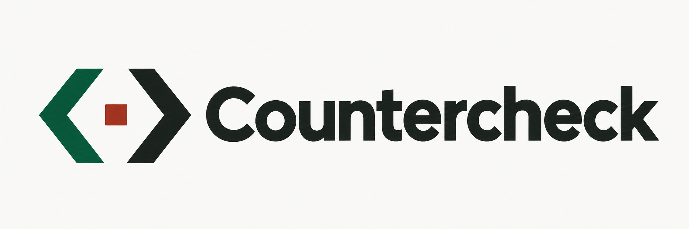

# Countercheck

<a href="https://countercheck.nicia.ai"></a>

Countercheck combines a contradiction-detection API with a reproducible evaluation harness for decision models. The stateless API compares one caller-supplied claim with up to twenty
caller-supplied texts. It reports pair-level contradictions, uncertainty, and the exact submitted
text IDs it evaluated. It does not retain a customer corpus, retrieve evidence, choose which text is
right, or decide whether a write should be admitted.

**[Try Countercheck online →](https://countercheck.nicia.ai)** — compare statements in your browser, choose a model, and create an API key. The hosted preview is invitation-only; request access on the site if you haven't been invited.

Start with the **[evaluation approach and results](EVALUATION.md)** if you build or evaluate decision models. You can recompute the published aggregate metrics and analysis offline without provider keys, Cloudflare, or a Countercheck account.

Hosted API: [OpenAPI](https://countercheck.nicia.ai/openapi.json) · [health](https://countercheck.nicia.ai/health). Hosting and authentication are separate from the evaluation toolkit.

The service is not yet qualified for production. The approved beta targets are evaluation gates,
not measured results: contradiction precision of at least 0.95, recall of at least 0.90, and a
definitive negative answer for at least 0.85 of clearly non-contradictory pairs, with confidence
intervals and category-level reporting. See [the design](docs/design.md) for the complete contract
and release protocol.

## Evaluation

**Latest: [separately fitted Nace Max/Finance results](EVALUATION.md#calibration-follow-up-max-and-max-finance)** — 6,400 new calls with policies frozen before validation. Max validates at **97.1% precision / 62.3% recall / 71.8% negative coverage**; Finance at **96.7 / 69.8 / 70.6**. Finance is competitive with calibrated Decider, but its paired intervals do not establish a win. Neither meets all three targets. The [eleven-model calibrated comparison](eval/results/nace-calibration-2026-11-06/README.md) includes the fixed negative-budget sensitivity grid and contract controls.

**New: [five-model Nace Drex extension](EVALUATION.md#nace-drex-extension-november-6)** — 4,600 additional assessments using the same frozen inputs and shipped policy. The [fourteen-model comparison](eval/results/nace-2026-11-06/README.md) keeps domains separate and adds ranking diagnostics and paired intervals. No Nace model/domain scorecard meets all three point targets; these routes remain evaluation-only.

**Disclosure (November 5, 2026):** Nicia has no commercial relationship with any evaluated model provider.

Our November 5, 2026 comparison covers **nine models and 8,280 scored observations**: the eight exposed models plus evaluation-only Fastino GLiDE 27B, each on the same 880 public pairs and 40 synthetic diagnostics. The public scorecards cover Wikipedia, science, commercial contracts, business-adjacent language and finance. Prompts and thresholds stayed fixed; failed and uncertain results remain in the denominators.

- **GLiDE’s negative-coverage lead is largely operating-policy dependent.** Under the shared shipped thresholds, it clears 22.6 points more MultiNLI negatives and 16.2 points more ContractNLI negatives than full Decider. With the separately fitted, post-hoc primary, the archived gaps shrink to 3.8 and 6.4 points, and validation point differences favor Decider. See [the shared-versus-model-specific comparison](EVALUATION.md#glide-and-decider-under-shared-and-model-specific-policies).
- **Its finance lead over Decider is inconclusive:** two additional detected contradictions yield a paired F1 interval that touches zero. GLiDE versus Jev on finance and Decider versus Jev on VitaminC have exploratory F1 intervals above zero on these samples.
- **Ranking and the shipped cutoff tell different stories.** Jev and Luna have nearly equal VitaminC AUROC (0.863 and 0.861), despite shipped F1 of 54.9% and 34.1%. The [analysis supplement](eval/results/hosted-models-analysis-2026-11-05/README.md) puts AUROC/AP and retrospective recall at ≥95% observed precision beside shipped behavior; the [GLiDE/Decider follow-up](EVALUATION.md#glide-and-decider-under-shared-and-model-specific-policies) is a concrete example of how model-specific operating points change a comparison.
- **Jev 1.14** was the fastest measured route (107 ms successful-call p95) and completed all 880 public pairs. Provider/kernel timing is not full deployed API latency.
- **No model met all three proposed quality targets together** on any public scorecard under the shipped policy. Retrospective threshold selection does not establish a validated operating point.

Four scorecards reuse development samples. FinDVer is a previously scored, untuned evaluation cohort. Fastino was added after the eight-model results were available. This was one pass, without an input-order test; upstream training exposure to these public corpora is unknown. The initial prompt-ablation study used Jev only; later quality iterations also explored Decider. These are development findings, not fresh held-out or unseen-to-model estimates.

Read **[the evaluation approach, complete tables, limitations and reproduction guide](EVALUATION.md)** for dataset adaptations, label semantics, error/abstention handling, calibration diagnostics, confidence intervals and instructions for bringing your own model. The [measured archive](eval/results/hosted-models-with-glide-2026-11-05/README.md) preserves redacted scoring rows and provenance.

The [initial calibration study](eval/results/separate-calibration-2026-11-05/README.md) adds 28,800 assessment attempts, then remaps the original probabilities offline. Its strict zero-false-clear budget caused a large negative-coverage loss. The [follow-up](eval/results/calibration-followup-2026-11-06/README.md) restores Jev validation with 688 successful calls and publishes a post-hoc per-model budget capped at each model's shipped-fit false clears, plus a fixed sensitivity grid. For those nine models, pooled validation negative coverage recovers to 36.1–79.4%; positive recall remains 24.1–67.5%. No primary model/domain meets all three point targets. Both versions and the original failed Jev run remain intact. The 204-item human packet is prepared, not yet labelled; shipped behavior is unchanged.

Hosted GLiDE 27B has an evaluation-runner adapter: 920 observations in the original comparison, plus 3,200 attempts in the separate calibration study. Its API/dashboard route has not been implemented. “Evaluation-only” describes that integration scope; it is not a separate model-quality tier. All eight exposed models are also unqualified previews. See [benchmark coverage versus API availability](EVALUATION.md#benchmark-coverage-and-api-availability); smaller GLiDE sizes remain unrun.

Verify all nine models' aggregate metrics and the post-hoc analysis using only Python and committed artifacts:

```sh
python3 -B scripts/verify-eval-release.py
```

Verify both calibration versions as well, including independent fitting, status-only diagnostics and point-metric checks:

```sh
python3 -B scripts/verify-calibration-followup.py
```

Verify the Nace shipped-policy extension and Max/Finance calibration study separately:

```sh
python3 -B scripts/compare-nace.py --verify eval/results/nace-2026-11-06
python3 -B scripts/analyze-nace-calibration.py --archive eval/results/nace-calibration-2026-11-06
```

To exercise the runner without credentials or model calls:

```sh
pnpm install --frozen-lockfile
pnpm eval:smoke
```

To run new experiments, see [bounded live runs](EVALUATION.md#run-a-new-evaluation), [custom scorer replay](EVALUATION.md#evaluate-your-own-model), the [runner reference](eval/README.md), and [business dataset preparation](eval/business/README.md). Each provider requires your own credentials; HTTPS-provider evaluations do not require a Nicia account. Live calls need explicit opt-in and call/spend reservations. Unknown billed cost is not reported as zero.

The [earlier profile-regression investigation](docs/evaluations/profile-regression-diagnosis.md), [controlled iterations](eval/results/quality-iterations-2026-11-03/README.md), and [offline DeBERTa baseline](eval/results/deberta-dev-2026-11-03/README.md) retain useful negative results and distinct training/coverage disclosures. The historical request-level admission benchmark is a different task and is not pair-level contradiction gold. None of these runs certifies production capacity or the service's human-adjudicated release gate.

## Dashboard beta

The dashboard includes invitation-only Better Auth accounts, one-time API key creation, a session-authenticated
playground, usage views and administrative pause controls. See [self-service beta](docs/self-service-beta.md)
for limits, telemetry and account behavior. Cloudflare Workers Builds deploys `main` from
[`nicia-ai/countercheck`](https://github.com/nicia-ai/countercheck); GitHub Actions runs checks only.
GitHub checks also exercise the offline analysis verifier. See [deployment](docs/deployment.md) for runtime setup and release gates.

## Local service quickstart

For evaluation only, use the [evaluation quickstart](EVALUATION.md#verify-the-published-numbers-offline); the dashboard and database are unnecessary.

The checked-in Wrangler configuration names the maintainer's Cloudflare account, domain and resources. For your own service deployment, configure your own account/resources and named Wrangler profile first; see [deployment setup](docs/deployment.md). The following commands are for a checkout already configured for your account.

Requirements: Node.js 24.22.2 and pnpm 11.20.0.

```sh
pnpm install
pnpm exec wrangler auth activate YOUR_PROFILE .
cp .dev.vars.example .dev.vars
pnpm exec wrangler d1 migrations apply countercheck --local --config wrangler.jsonc
pnpm dev
```

Set the account variables described in `.dev.vars.example`, including a dedicated auth secret,
Resend credential and bootstrap administrator email. Open `/dashboard`, request a sign-in link for that address,
and follow the emailed link to verify mailbox access and create a key. The dashboard displays the `cck_...` API key once; save it securely.
The server stores only its SHA-256 hash. Existing operator-issued keys require explicit tenant
enrollment through the authenticated operator controls; creating a key alone no longer grants
inference access. Use `pnpm keys ... --remote` only when deliberately operating on the configured
remote database.

Set a valid provider credential in `.dev.vars` as `TYPESAFE_API_KEY` before calling the API. This
credential is used by the Jev provider; the local API does not have an auth bypass or a fake-model
fallback. The `AI` binding and optional `OPENAI_API_KEY` and `OPENROUTER_API_KEY` secrets enable the
other hosted routes described in [supported models](docs/models.md). Keep `.dev.vars` private and
never commit it. Start the Worker with `pnpm dev`; Wrangler
prints its local address (normally `http://localhost:8787`).

Call the local Worker with curl:

```sh
export COUNTERCHECK_URL=http://localhost:8787
read -rs COUNTERCHECK_API_KEY
export COUNTERCHECK_API_KEY
curl --fail-with-body --silent --show-error \
  -H "Authorization: Bearer $COUNTERCHECK_API_KEY" \
  -H 'Content-Type: application/json' \
  --data '{"claim":{"id":"new-policy","text":"The Starter plan includes SSO."},"against":[{"id":"current-policy","text":"The Starter plan does not include SSO."}]}' \
  "$COUNTERCHECK_URL/v1/check"
unset COUNTERCHECK_API_KEY
```

The same request using Node's built-in `fetch`:

```sh
read -rs COUNTERCHECK_API_KEY
export COUNTERCHECK_API_KEY
node --input-type=module <<'NODE'
const response = await fetch(`${process.env.COUNTERCHECK_URL}/v1/check`, {
  method: "POST",
  headers: {
    authorization: `Bearer ${process.env.COUNTERCHECK_API_KEY}`,
    "content-type": "application/json",
  },
  body: JSON.stringify({
    claim: { id: "new-policy", text: "The Starter plan includes SSO." },
    against: [{ id: "current-policy", text: "The Starter plan does not include SSO." }],
  }),
});
console.log(response.status, await response.json());
NODE
unset COUNTERCHECK_API_KEY
```

The response is probabilistic. `no_contradiction_detected` means the detector did not identify a
contradiction in that submitted pair; it is not proof that the texts are consistent. A `completed`
response means all requested pairs were assessed, including pairs whose verdict is `uncertain`.
Verdicts belong to `comparisons[]` only; there is no top-level verdict.
See [the API and semantic contract](docs/design.md#http-api).

## Supported models

Jev 1.14 is the default. The hosted selector includes:

| Request `model`                      | Provider route        |
| ------------------------------------ | --------------------- |
| `jev-1.14.0`                         | TypeSafe              |
| `clef`                               | Cloudflare Workers AI |
| `clef-flash`                         | Cloudflare Workers AI |
| `clef-omni`                          | Cloudflare Workers AI |
| `gpt-6-luna`                         | OpenAI Decisions      |
| `microsoft/microsoft-decision-1`     | OpenRouter            |
| `perplexity/pplx-decider-v1.2`       | OpenRouter            |
| `perplexity/pplx-decider-flash-v1.2` | OpenRouter            |

The dashboard lists every supported ID and marks models whose provider is not configured; all models
share account limits. `GET /v1/models` exposes the same catalog and configuration flags without
running inference. `configured` reflects credential or binding presence, not credential validity or
provider health. OpenAI Decisions and OpenRouter credentials are optional runtime secrets. See
[model selection and provider details](docs/models.md) and [deployment](docs/deployment.md).

## Experimental decision profiles

The default remains `balanced-v1`. Explicitly select `semantic-v2` for a compact shared rubric
with contrastive examples, or `structured-value-v1` for bounded value selection and deterministic
interval comparisons. Both are experimental. Structured responses expose a choice distribution
rather than inventing four-way `raw_scores`; check the signal representation before reading it.
See [profile behavior and qualification](docs/decision-engineering.md) and the
[engineering evaluation workflow](eval/engineering/README.md). Local changes do not update the hosted preview automatically.

## Development checks

```sh
pnpm check       # TypeScript, ESLint, and Prettier
pnpm test        # Unit and integration tests
pnpm smoke       # Local API smoke test
pnpm build       # Wrangler Worker dry run; does not deploy
```

An IP ingress limiter protects checks and private readiness before parsing or D1 lookup; an independent
per-key limiter protects inference. Both are approximate per Cloudflare location, not global quotas.
Ingress and body parsing share a 2-second budget.

The service stores API key hashes and daily aggregate usage in D1, but no request text or provider
output. Application code must not log customer text, caller IDs, keys, upstream error bodies, or
model outputs. Wrangler enables Workers observability with query-string redaction and disables
automatic invocation logs; the platform retention limit for Workers Logs is seven days. Do not add
request-body logging or trace payloads.

Usage counters are advisory: their token counter is the subtotal of reported input tokens, with
`unknown_token_requests` tracking missing usage separately. They are not a billing ledger. The
response preserves missing provider usage as `null`.

A daily midnight-UTC scheduled handler removes aggregate usage outside the current and preceding
29 UTC dates, even when no successful requests arrive. Operational failures of that cleanup must
be monitored like other scheduled-worker failures; this is a daily retention policy, not a precise
per-row thirty-day timer.

## Deployment

Deployment is pinned to a dedicated Cloudflare D1 database and account ID in `wrangler.jsonc`, plus
Cloudflare account credentials and a provider credential in the `TYPESAFE_API_KEY` secret. The
configured custom domain is `countercheck.nicia.ai`; the production WAF rule must cover it before
customer traffic. A controlled authenticated preview uses the native ingress limiter while that
production gate is pending. Cloudflare Workers Builds deploys `main` from
`nicia-ai/countercheck` using `pnpm ci:build` and `pnpm ci:deploy`; GitHub Actions runs checks only.
The deploy preflight verifies runtime secret names and applies D1 migrations before publishing.
Runtime secrets stay on the Worker, separate from build credentials. Deployment does not create
Cloudflare resources or qualify the model for production use. Follow
[the deployment notes](docs/deployment.md) and the release gates in
[the design](docs/design.md#evaluation-and-release-gates).

## Licensing

Original software and documentation are licensed under [Apache 2.0](LICENSE). See [NOTICE](NOTICE) for project attribution and [DATA_NOTICE.md](DATA_NOTICE.md) for the separate dataset, model, and third-party terms. The [publication review](docs/publication-review.md) records the credential/data checks, omitted internal material, and the Git-history cleanup and its limits.
