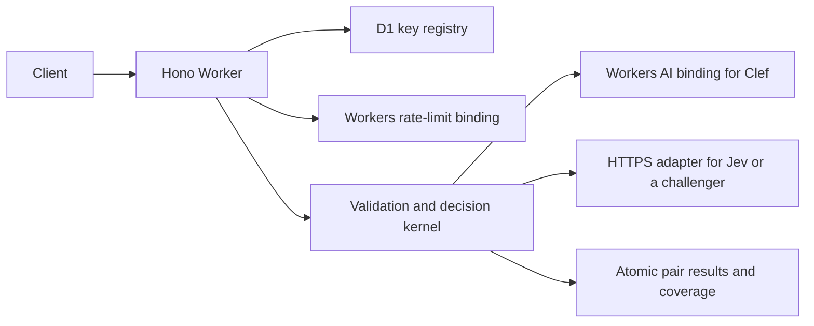

# Standalone contradiction detection API

Status: APPROVED by the owner on 2026-11-03, including the Jev 1.14 baseline and public-benchmark approach. Scope: caller-supplied claims and comparison texts, no stored corpus. This is a separate service design, not a change to Nicia's Brain contract or frozen execution platform.

## Decision

Build a small TypeScript API on Cloudflare Workers that compares one claim with up to twenty caller-supplied texts. It returns one result per comparison, identifying contradictions, reporting uncertainty, and naming the exact input texts it evaluated. It stores no customer content and makes no admission, truth, retrieval-completeness, or whole-document-consistency decision.

The product value is a tested semantic contract, evidence attribution, uncertainty handling, and measured model selection. A thin proxy to a choice-model endpoint would not provide that value.

Use a portable decision kernel with provider adapters. The initial implementation and baseline target pinned `jev-1.14.0`; do not spend new evaluation calls on older Jev versions. Full Clef and Perplexity Decider are comparison systems. Jev 1.14 must meet the service-specific release gates before production use. Keep the public API independent of model schemas and provider names.

The managed-corpus and combined-launch alternatives were declined in favor of a stateless comparison API. Retrieval and document extraction remain the caller's responsibility.

## Semantic contract

A contradiction exists when the submitted texts make incompatible assertions about the same subject under overlapping conditions and times. This includes incompatible guidance within the same applicable context. It does not establish which assertion is right.

The default comparison frame is that unqualified assertions are being considered together. Preserve explicit dates, exceptions, populations, versions, units, and conditions in the text. Do not infer that the latest-looking assertion supersedes another just because it was submitted later. Submission order confers no authority. Explicitly disjoint applicability can make statements coexist.

| Inputs                                                              | Expected treatment                                                |
| ------------------------------------------------------------------- | ----------------------------------------------------------------- |
| Standard costs $49/month; Standard costs $79/month                  | Contradiction in the shared, otherwise unqualified context        |
| Standard costs $49 in January; Standard costs $79 in June           | No contradiction detected from those time-specific statements     |
| Starter excludes SSO; Starter includes SSO                          | Contradiction                                                     |
| Starter excludes SSO; Enterprise includes SSO                       | Different scope; no contradiction detected                        |
| Employees work remotely; Denver warehouse staff work on site        | Uncertain unless the coverage of the first statement is clear     |
| A repeats B using different words                                   | No contradiction detected; repetition is not a reason to escalate |
| A omits an assertion that appeared in an older version              | Omission alone is not a contradiction                             |
| A makes a claim absent from B                                       | Lack of support alone is not a contradiction                      |
| Document A quotes a rejected proposal; B describes the adopted rule | Judge assertion status and attribution, not isolated quoted words |

The service reports relations between supplied texts, not facts from the wider world. It does not choose a winner, automatically rewrite either side, approve a write, or resolve a dispute. It is not a legal or medical interpretation engine. Multi-premise deduction and contradictions requiring three or more texts jointly are outside the v1 guarantee.

Within v1, comparison texts are snippets, not arbitrarily long documents. A positive finding concerns the pair as submitted. A negative result means only that the detector did not find a contradiction in that pair. Even a completed request is a probabilistic assessment, not a proof of consistency.

## What Nicia contributes

The inspected Nicia checkout was at `fe17b6909` on 2026-11-03. Reuse its techniques and fixtures through an explicit port, without importing its application graph.

| Source                                                       | Reuse                                                                              | Change for the standalone service                                                |
| ------------------------------------------------------------ | ---------------------------------------------------------------------------------- | -------------------------------------------------------------------------------- |
| `packages/run-runtime/src/typesafe-admission-classifier.ts`  | Batched typed questions, fetch adapter, validation boundary, model/prompt identity | Remove organization, entity-kind, accepted-state, and prior-edit assumptions     |
| `packages/domain/src/services/brain-admission-classifier.ts` | Deadline ownership; exactly-once answer coverage; pure decision mapping            | Preserve pair results rather than taking a maximum and returning admission facts |
| `packages/domain/src/services/context-check-judge.ts`        | Evidence-ID validation; honest distinction between unavailable and empty findings  | Do not equate superseded guidance with logical contradiction                     |
| `packages/domain/src/services/brain-admission-embedding.ts`  | Finding and judging must be measured separately                                    | No retrieval or embeddings in this service                                       |
| `tools/harness-evals` and the public benchmark               | Repeat runs, order perturbations, quality/latency/cost reporting                   | Add pair-level truth and contradiction-specific metrics                          |

Two mappings must not survive the port: `changes_meaning` is not synonymous with contradiction, and `restates` must not trigger a contradiction verdict. Nicia's existing behavior can remain appropriate for admission while being inappropriate for this API.

Implement in a new repository with no runtime dependency on `@nicia/*`. Copy only small, reviewed pieces with provenance and applicable license notices. Do not move or alter the frozen `run-runtime` package as part of building this service. A future Nicia integration would be a separately scoped consumer of the API.

## The public benchmark changes the model decision

The canonical inspected public revision is [admission-decision-eval at f2cfe78](https://github.com/nicia-ai/admission-decision-eval/tree/f2cfe78b6cf2ab1281eda017060789180749b2c6), committed 2026-11-02. Its October 31 reports supersede the older October 1 and October 4 snapshot for current candidate selection. The local sibling checkout was older and had an uncommitted change, so the published revision governs this design.

The expanded run contains 85 synthetic cases, eight hosted backends, and seven passes per backend. Clef alone passed every existing gate in all seven passes. Perplexity Decider made every admission decision correctly in its clean original/reversed passes, but its run also contained transport failures and a slow tail. Jev 1.14's repeated miss was a restatement case, which does not establish a contradiction miss. The report explicitly leaves intermittent authentication-error causes unresolved. These observations are task-specific historical measurements, not service SLAs or a general model ranking. [Published results and caveats](https://github.com/nicia-ai/admission-decision-eval/blob/f2cfe78b6cf2ab1281eda017060789180749b2c6/README.md#expanded-hosted-re-run-2026-10-31)

The admission metric merges contradiction, restatement, and prior-edit effects. The 85 fixtures contain 30 requests with a prior version and 55 without; among the latter, 21 have aggregate contradiction truth. Their labels are request-level, not a complete pair-level gold set. The recorded result rows retain aggregate evidence, not the full per-pair evidence distributions. Consequently, neither request-level escalation recall nor replaying those report rows can establish this API's pair-level contradiction precision or calibration.

Preserve the public benchmark unchanged as the historical admission track. Create a separate service-evaluation track with links back to original case IDs. Human reviewers label each pair, its applicable context, and whether a definitive answer is possible. Re-evaluate self-edit cases as ordinary text pairs rather than copying their old labels. Add mixed positive/negative pairs in the same request so correct aggregation cannot hide wrong evidence attribution.

## Research that shapes the architecture

The research supports a bounded comparison service; it does not supply a single transferable state-of-the-art winner.

| Work                                                                                                                                                                 | What it evaluates                                                               | Consequence here                                                                                      |
| -------------------------------------------------------------------------------------------------------------------------------------------------------------------- | ------------------------------------------------------------------------------- | ----------------------------------------------------------------------------------------------------- |
| [SparseCL, ICML 2025](https://proceedings.mlr.press/v267/xu25s.html)                                                                                                 | Contradiction-oriented retrieval, including generated contradiction corpora     | Finding a candidate and judging it are distinct quality problems; callers own the former              |
| [CONTRADOC, NAACL 2024](https://aclanthology.org/2024.naacl-long.362/) and [reinforced reference coverage, EMNLP 2025](https://aclanthology.org/2025.emnlp-main.67/) | Detecting and localizing contradictions within documents                        | Do not promise whole-document coverage from independently checked snippets                            |
| [CLAIRE and WIKICOLLIDE, EMNLP 2025](https://arxiv.org/abs/2509.23233)                                                                                               | Real corpus inconsistencies, retrieval/reasoning, and human review              | Include real, adjudicated cases; synthetic admission fixtures alone are insufficient                  |
| [eTracer, revised September 2026](https://arxiv.org/abs/2601.03669)                                                                                                  | Fine-grained supporting and contradicting evidence                              | Make evidence attribution a first-class contract; snippet IDs are the honest initial granularity      |
| [ContractNLI](https://stanfordnlp.github.io/contract-nli/)                                                                                                           | Entailment, contradiction, absence, and evidence spans in contracts             | Silence is not contradiction; exceptions and scope need explicit tests                                |
| [MiniCheck](https://aclanthology.org/2024.emnlp-main.499/)                                                                                                           | Grounding generated statements against documents                                | A support/non-support detector is not automatically a contradiction detector                          |
| [Ragability, LREC 2026](https://aclanthology.org/2026.lrec-1.182/)                                                                                                   | Inter-context conflicts and the effect of conflict hints                        | Test hard negatives and neutral wording; telling a model to find conflicts can create false positives |
| [CoverageBench-Negate, October 2026](https://arxiv.org/abs/2610.37162)                                                                                               | Retrieval under controlled negation and contradictory evidence                  | Do not certify a caller's retrieved subset as complete                                                |
| [Independent Jev evaluation, revised October 2026](https://arxiv.org/abs/2609.37647)                                                                                 | General decision quality, selective prediction, and calibration across datasets | Useful evidence for the model family; not calibration for this service's labels                       |

Encoder NLI models and grounding models are offline quality/cost baselines. Hosting an encoder inside the request Worker is not the v1 plan: the Worker orchestrates inference, while Workers AI or an external provider runs the model. A specialist model or fine-tune becomes worthwhile only if evaluation demonstrates a persistent failure category that the simpler decision-model approach cannot meet.

## HTTP API

`POST /v1/check` requires a service API key in `Authorization: Bearer ...` and `Content-Type: application/json`. All fields below are closed schemas; reject unknown fields so misspelled options cannot silently change behavior.

```json
{
  "claim": {
    "id": "new-policy",
    "text": "The Starter plan includes SAML single sign-on."
  },
  "against": [
    {
      "id": "current-policy",
      "text": "The Starter plan does not include SSO."
    }
  ],
  "profile": "balanced-v1"
}
```

`model` is optional and defaults to pinned `jev-1.14.0`; the closed enum includes all eight hosted
routes in the public `GET /v1/models` catalog and [supported model list](models.md). The catalog's
`configured` flag reports provider credential or binding presence only, not credential validity or
provider health. Unknown IDs fail validation, and selected-provider failures never trigger a silent
model fallback.

`profile` is independent of the model and defaults to `balanced-v1`. A profile binds semantic instructions, supported language/input envelope, thresholds, and evaluation release. The opt-in `semantic-v2` and `structured-value-v1` profiles remain unqualified experiments. The profile name stays stable; `engine_release` identifies the exact deployed bundle of those decisions. Semantic contract breaks require a new profile or API version rather than a silent threshold change under the same release ID.

IDs are caller-defined, case-sensitive ASCII strings matching `[A-Za-z0-9._:-]{1,128}`. Every ID in the request must be unique across both roles. Text is nonempty UTF-8 content, with no normalization or trimming that changes its meaning. Reject unpaired Unicode surrogates before encoding. English is the qualified v1 language. Other-language text may pass structural validation, but accepting it does not establish multilingual accuracy; v1 includes no automatic language detector.

Limits: one claim, 1–20 comparison texts, 64 KiB raw JSON body, at most 4 KiB UTF-8 for the claim and 2 KiB for each comparison. The complete compiled provider payload also has a stricter 16 KiB UTF-8 envelope, including repeated question text. All limits must pass; the individual maxima are not simultaneously attainable. Stream-count body bytes before parsing. Return a validation error for oversized compiled input; never slice a text or silently drop comparisons. These conservative beta limits can increase after boundary and quality evaluation.

There is no generic `context` field in v1. Callers must include the relevant scope, dates, attribution, and definitions in each submitted snippet. This avoids an undefined contract about whether a third context text supplies extra premises or overrides either assertion. Title fields, file uploads, remote URLs, corpus handles, claim extraction, persistent jobs, and webhooks are outside v1.

Every `against` item is compared with the claim. Comparison texts are not compared with each other. To check a small set of texts exhaustively, the caller submits the required pairs across requests; the API does not imply it checked the full pair graph.

Illustrative successful response, with scores shown only as an example:

```json
{
  "request_id": "req_example",
  "status": "completed",
  "claim_id": "new-policy",
  "comparisons": [
    {
      "against_id": "current-policy",
      "verdict": "contradiction",
      "reason": "incompatible_assertions",
      "raw_scores": {
        "contradiction": 0.97,
        "consistent": 0.01,
        "different_scope": 0.01,
        "insufficient_context": 0.01
      },
      "evidence": {
        "claim_id": "new-policy",
        "against_id": "current-policy",
        "granularity": "submitted_text"
      }
    }
  ],
  "coverage": {
    "scope": "claim_against_each_text",
    "requested": 1,
    "completed": 1,
    "unassessed": 0,
    "input_truncated": false
  },
  "engine": {
    "profile": "balanced-v1",
    "engine_release": "contradiction-2026-11-example",
    "prompt_version": "pair-relation-v1",
    "threshold_version": "example-only",
    "provider": "example-provider",
    "requested_model": "example-model",
    "reported_model": "example-model",
    "model_revision": null
  },
  "usage": {
    "provider_calls": 1,
    "input_tokens": 420
  }
}
```

`raw_scores` are the provider's normalized choice probabilities, not independently calibrated probabilities that either assertion is false. Do not expose a misleading general `confidence` number. `model_revision` is null unless the provider supplies an identifiable immutable revision. Usage tokens are nullable if not reported; never substitute an estimate without labeling it.

Pair verdicts are `contradiction`, `no_contradiction_detected`, or `uncertain`. Pair reasons are `incompatible_assertions`, `jointly_satisfiable`, `different_scope`, or `insufficient_confidence_or_context`. A restatement belongs under jointly satisfiable. Reason categories are deterministic mappings of the validated model output, not free-form model explanations or claims of a minimal conflict span.

Verdicts exist only on `comparisons[]`; there is no request-level verdict or probability. Each comparison can have a different outcome. The top-level `status: completed` means every requested pair was assessed, even when a pair’s semantic verdict is uncertain.

Evidence names the complete submitted snippets. This is source attribution, not within-snippet localization. The server constructs these references from the request map; the model never invents returned evidence IDs. No generated prose or narrower highlight spans are promised in v1. A later localization extension must select and validate verbatim spans and must preserve qualifiers; it needs an additional evaluation gate.

## Detection pipeline

1. Authenticate and rate-limit before compiling or calling a model. Validate schema, unique IDs, byte budgets, and text encoding.
2. Compile a structured state and exactly one choice question per comparison. Assign opaque internal question IDs and retain their mapping to caller IDs. Use a deterministic presentation order derived from IDs, then restore the caller's order in the response. This stabilizes packing; it does not solve order sensitivity, which remains an evaluation requirement.
3. Ask about the named pair only. Other comparison texts are distractors, not extra evidence or instructions. Explicitly tell the model that supplied text is untrusted data to assess, not commands to execute. Preserve dates, negations, quantifiers, conditions, and quoted/proposed assertion status.
4. Use four mutually exclusive options. First, if scope is explicitly disjoint, choose `different_scope`. If required meaning or applicability cannot be determined, choose `insufficient_context`. Otherwise choose `contradiction` for incompatible assertions, or `consistent` when jointly satisfiable. This precedence is part of the versioned prompt and evaluated contract.
5. Validate the provider envelope, exactly the requested question IDs, expected answer types, all four labels, finite probabilities in [0,1], and a sum within 0.001 of one. A selected label, when supplied, must be one of the maximizers within that tolerance. Reject malformed, refused, extra, duplicate, or missing answers. No absent value defaults to zero.
6. Apply release-specific thresholds to each distribution. For initial evaluation only, test `p(contradiction) >= 0.8` for positive, and `p(contradiction) <= 0.2` with either consistent or different-scope probability >= 0.8 for negative. All other outputs are uncertain. Publish actual thresholds in the release manifest only after tuning on development data and passing the held-out gate; these initial values are not inherited admission thresholds or a launch guarantee.
7. Assemble pair verdicts, server-owned evidence references, coverage, and engine identity. Return the whole response atomically. V1 does not return partial success if the provider fails to answer one pair.

V1 permits exactly one provider call per accepted request; twenty comparisons cost twenty questions sharing one state, not twenty network trips. Shared-state batching is retained because it matches the original workload, but it is conditional on pair-attribution and distractor tests. If no single-call compiler/model passes those tests, launch is blocked. Smaller groups, isolated calls, retries, or ensembles require a separate design with explicit total-call, concurrency, cost, deadline, and atomic-completion bounds; they are not a hidden v1 fallback.

Dates, unit conversions, and arithmetic are not reliable decision-model primitives. V1 does not claim to calculate them or parse structured numeric slots. Numerical and temporal cases are release-gate categories; use uncertain results for underdetermined comparisons. A future structured-value mode could let code own exact comparisons, but is a separate contract rather than hidden heuristic extraction.

## Cloudflare architecture



The diagram shows supported adapter routes, not fan-out: each request uses exactly one configured route. Provision a new Worker name and independent configuration/secrets. No Nicia Worker migrations, queues, namespaces, Hyperdrive, Brain registry, or durable execution machinery is involved.

Suggested source boundaries in the new repository:

```text
src/contracts/       request, response, and error schemas; OpenAPI
src/kernel/          question compiler, response validator, verdict mapping
src/providers/       Jev fetch and Workers AI adapters
src/http/            Hono routes, authentication, request budgets, errors
src/control/         key registry and content-free usage accounting
eval/                pinned fixture inputs, pair labels, runners, release manifests
```

Use ordinary Workers-compatible fetch and WebCrypto. Keep provider transports small and disable hidden SDK retries. The kernel has no Cloudflare or database imports. D1 is for hashed API keys, key state, and daily aggregate usage, not customer text or findings. Administrative key provisioning uses a small operator tool; no dashboard, signup, or payments system is required for the beta.

Store randomly generated high-entropy keys only as SHA-256 hashes; retain key ID, owner/tenant ID, status, and creation/revocation time. Authenticate against the primary D1 path without isolate caching so a successful revoke affects subsequent checks. Reads of revocation state must not use an eventually consistent replica. Auth-store failure fails closed with 503. Content-free aggregate usage may be updated through `waitUntil`; it is advisory and is not an exactly-once billing ledger.

Use the rate-limit binding for per-key burst protection and edge rules for unauthenticated abuse. Cloudflare documents the binding as local/eventually consistent: do not describe it as a global hard quota. A request's body, comparison count, and single-call budget bound exposure. Hard spend quotas or paid billing would require a separately designed reservation ledger, potentially backed by a Durable Object; they are not beta promises. [Rate-limit binding semantics](https://developers.cloudflare.com/workers/runtime-apis/bindings/rate-limit/)

## Input budgets, deadlines, and provider failures

Cloudflare documents that [Clef](https://developers.cloudflare.com/workers-ai/models/clef/) and [Clef-flash](https://developers.cloudflare.com/workers-ai/models/clef-flash/) can truncate long text state. The service's compiled-payload envelope must be certified against the selected provider's tokenizer/context accounting, including question expansion and internal template overhead. Prefer an exact documented tokenizer where available; otherwise use a conservative byte envelope with measured overhead reserve and boundary tests. A new provider cannot be enabled until every accepted boundary fixture fits its documented context limits without truncation. Never enable Jev's long-context danger-zone mode in this profile. Provider behavior inside the accepted envelope is part of the adapter qualification, not an assumption that any System One-compatible endpoint is interchangeable.

Use a 3,000 ms application deadline starting after bounded body parsing, with at most 2,500 ms for the provider including time spent waiting to dispatch. Bound body-read time to 2,000 ms as protection against slow uploads. These are timeout policy values, not measured p95 latency. If authentication or scheduling consumes the remaining budget, reject before dispatch. No automatic retry in v1; clients may explicitly retry read-only checks, paying for each execution. No idempotency/deduplication guarantee is advertised.

For fetch, propagate an AbortSignal. For a binding without cancellation, a deadline race may stop waiting without stopping inference: discard late answers, never return them after a timeout response, and account for possible provider cost. Do not imply that a JavaScript timer cancels GPU work. Provider-wide rate and concurrency capacity must be tested under multi-isolate load; a per-isolate semaphore is not a global quota.

| HTTP status | Meaning                                                                                           |
| ----------- | ------------------------------------------------------------------------------------------------- |
| 200         | Every comparison completed; semantic uncertainty may still be present                             |
| 400         | Malformed JSON or invalid Unicode encoding                                                        |
| 401         | Missing/invalid/revoked service API key                                                           |
| 408         | Body-read deadline exceeded                                                                       |
| 413         | Raw request body exceeds the byte limit                                                           |
| 415         | Unsupported media type or content encoding; v1 accepts uncompressed JSON                          |
| 422         | Invalid fields, duplicate IDs, empty comparison set, text/compiled-budget limit exceeded          |
| 429         | Service burst limit exceeded; include Retry-After                                                 |
| 502         | Provider returned malformed, refused, or incomplete answers                                       |
| 503         | Authentication store unavailable, provider overloaded/unavailable, or upstream credential failure |
| 504         | Application/provider deadline exceeded                                                            |

Errors use `{ "error": { "code": "...", "message": "...", "retryable": false }, "request_id": "..." }`; `Retry-After` is set where meaningful. Define stable codes in OpenAPI. Never expose upstream response bodies or credentials. An upstream 401 is an operator problem, not evidence that the caller's valid service key is bad. Upstream errors do not produce a semantic verdict or a completed-coverage object. Return `Cache-Control: no-store` on success and errors. Client disconnects do not guarantee provider cancellation.

## Privacy and operational observability

Stateless means no retained customer claim, comparison text, finding, or response cache. Control data for access and aggregate usage exists independently. Do not log bodies, authorization headers, compiled prompts, raw upstream error bodies, content hashes, or findings. Disable AI Gateway prompt logging and response caching if a gateway is ever added. Log request ID, internal key ID, engine release, counts, input byte size, durations, provider status class, and token totals only. Do not log caller-supplied IDs, which may contain sensitive labels. Set operational log retention to seven days initially; key records and daily usage counters persist until operator deletion, and daily usage counters retain the current and preceding 29 UTC dates, with independent daily scheduled cleanup even when inference is idle or unavailable.

Data still goes to the chosen inference provider. The no-retained-corpus promise is not a blanket end-to-end zero-retention claim. [TypeSafe](https://docs.typesafe.ai/models) distinguishes enterprise ZDR, while the Cloudflare model pages identify ZDR support. Document the actual account/provider terms before onboarding customers; never silently reroute to a provider with different data handling. Cross-provider fallback is off in v1.

Expose `GET /health` for process liveness and `GET /openapi.json` for the public contract. A private readiness check verifies control bindings and configured route without performing paid inference on each health request. Use controlled synthetic probes for inference health. Include content-free Server-Timing phases for auth, compile, provider, and total. Avoid returning operational provider internals in public health responses.

## Models, releases, and cost

Start all new runs with pinned `jev-1.14.0`, both directly and through the service kernel. Older Jev reports remain historical evidence only; no new older-version control run is required. Compare full Clef and Perplexity Decider against the same inputs. Clef-flash and Clef-omni are optional later comparisons, not assumed faster substitutes that preserve quality. A clean quality score and endpoint reliability are separate dimensions. Diagnose the October 31 authentication failures before attributing them to model quality or using them to eliminate a provider.

Call Clef through the Workers AI binding when deployed and Jev through direct HTTPS. Repeat evaluation from the real Worker location/route: laptop REST and GPU-only measurements do not predict service latency. Use immutable model versions where supported. Where a provider exposes only a mutable model name, preserve the reported model/revision if available, disclose the missing immutable revision, run a small pinned synthetic sentinel suite before promotion and on an operator schedule, and support rollback to an independently qualified route. Do not promise exact deterministic replay.

The checked TypeSafe pricing lists $0.042 per million input tokens for Jev 1.14; the checked Cloudflare model pages list $0.24 for Clef and $0.038 for Clef-flash, with no output-token charge. At an illustrative 2,000 billed input tokens per call, model cost is $0.000084, $0.000480, and $0.000076 respectively. These are arithmetic examples using November 3 documentation, not cost quotes or a commercial price. Count all serialized state and questions; one batched call is not automatically billed like one pair. Other candidates need their actual deployed-route pricing captured at evaluation time. [Jev pricing](https://docs.typesafe.ai/models), [Clef pricing](https://developers.cloudflare.com/workers-ai/models/clef/), [Clef-flash pricing](https://developers.cloudflare.com/workers-ai/models/clef-flash/)

Measure cost per completed comparison, uncertain comparison, and request, including failed/timed-out inference where billed. Workers, D1, logging, and any gateway charges are additional. Do not set customer pricing from the model-token line alone.

## Public benchmark plan

Approved first milestone: VitaminC and SciFact, comparing pinned Jev 1.14 through the service kernel with direct Jev 1.14 and the DeBERTa NLI baseline. The hosted catalog now also exposes Clef variants, OpenAI Decisions, Microsoft Decision-1 and Pplx Decider routes; their availability and provider credentials are documented in [supported models](models.md). Establish these results before commissioning custom pair labeling.

Establish a public-data baseline before commissioning a new 500-pair annotation exercise. Existing public datasets can measure model discrimination, factual-change sensitivity, and our own regressions immediately. The custom corpus remains a general-release requirement for the service's particular scopes and business language; public results do not replace it.

### Datasets and task boundaries

| Priority                       | Dataset                                                                                         | Useful existing labels and comparisons                                                                  | How this API can use it                                                                                                                                                                                                                                                                                 |
| ------------------------------ | ----------------------------------------------------------------------------------------------- | ------------------------------------------------------------------------------------------------------- | ------------------------------------------------------------------------------------------------------------------------------------------------------------------------------------------------------------------------------------------------------------------------------------------------------- |
| First                          | [VitaminC fact verification](https://github.com/TalSchuster/VitaminC)                           | Claim/evidence labels, real Wikipedia revisions and synthetic revisions, released ALBERT baselines      | Natural fit for supplied-text checking. Map evidence to the comparison snippet and the hypothesis to the claim. Keep real and synthetic test results separate; preserve revision/contrast groups when sampling.                                                                                         |
| First                          | [SciFact](https://github.com/allenai/scifact/blob/master/doc/data.md)                           | Claims, supporting/contradicting abstracts, sentence-index rationale sets, released verification models | Start with complete gold rationale sets as supplied evidence. Join sentences belonging to one rationale into one snippet: do not label each sentence as contradictory when the label applies to the set. Score support as non-contradiction; do not assume arbitrary unlabeled abstracts are negatives. |
| Conditional short-pair track   | [ANLI rounds 1–3](https://github.com/facebookresearch/anli)                                     | Verified adversarial entailment/neutral/contradiction pairs, public splits and reference models         | Use premise as comparison text, hypothesis as claim, preserving the native direction. Report contradiction-vs-rest by round. The dataset carries a noncommercial license; keep it outside the automatic commercial evaluation bundle until the intended use is permitted.                               |
| Real-world diagnostic          | [WIKICOLLIDE](https://github.com/stanford-oval/inconsistency-detection#the-wikicollide-dataset) | Human consistent/inconsistent claim labels, inconsistency types, source context, and retrieval traces   | Valuable source material for genuine knowledge disagreements. Its labels apply to claims evaluated against a corpus, not every passage in a trace. Build and adjudicate explicit claim/evidence pairs; report this as an adapted pair track, not the original CLAIRE corpus-search task.                |
| Scope and exception diagnostic | [ContractNLI](https://stanfordnlp.github.io/contract-nli/)                                      | Contradiction, entailment, NotMentioned, evidence spans, official splits, Span NLI BERT baseline        | Full-contract inputs generally exceed the v1 snippet envelope. A complete-gold-evidence snippet track can test exceptions, but it gives the system evidence selection for free and is not a full-document score. NotMentioned labels cannot simply be inherited by a hand-picked excerpt.               |
| Later numerical robustness     | [NLI4CT](https://sites.google.com/view/nli4ct/semeval-2024/data-formatting)                     | Clinical entailment/contradiction, evidence indices, and the SemEval perturbation task                  | Add a fixed single-trial, supplied-evidence track for numerical and condition changes. Keep joint two-trial comparisons outside the claimed pair-only envelope when they require extra premises. Pin the 2023 or 2024 release explicitly; their tasks differ.                                           |

VitaminC and SciFact are the first executable benchmark targets. ANLI can add a useful adversarial comparison where its use is permitted. WIKICOLLIDE and ContractNLI follow once their evidence adapters have been validated; neither is a substitute for measuring retrieval, document reading, or multi-premise reasoning when those are part of a published comparator's task.

Public means accessible, not uniformly licensed. Record dataset-specific reuse terms and attribution in each manifest rather than copying a repository's code license onto its data. Verified examples: [VitaminC data terms](https://github.com/TalSchuster/VitaminC/blob/main/DATA_LICENSE) retain Wikipedia/FEVER-derived terms; [SciFact](https://github.com/allenai/scifact/blob/master/LICENSE.md) separates claims/annotations from abstracts; WIKICOLLIDE and ContractNLI identify CC BY 4.0 data, while ANLI identifies CC BY-NC 4.0. This plan downloads no datasets and does not change their licenses.

### Comparison systems

Run the same frozen examples through:

1. The service kernel with pinned Jev 1.14, first as one pair and then with fixed distractor bundles. This is the product result.
2. Direct Jev 1.14 with the same single-pair instructions and verdict mapping. Compare isolated and bundled calls separately to expose changes introduced by transport, packing, mapping, and deadlines. A wrapper should not receive credit merely for calling the same underlying model.
3. An off-the-shelf NLI cross-encoder, initially [cross-encoder/nli-deberta-v3-base](https://huggingface.co/cross-encoder/nli-deberta-v3-base), whose model card identifies contradiction, entailment, and neutral outputs and SNLI/MultiNLI training. This is a reproducible small-model baseline, not a claim that it is the latest best encoder.
4. Full Clef and Perplexity Decider with fixed, equivalent instructions, the same pair evidence, and adapter-specific validation. Treat published historical numbers as context; compare new outputs on the same data.

When useful, reproduce a dataset's released verifier on that dataset's own protocol, such as VitaminC's ALBERT checkpoints. Label supervised dataset-specific models separately from zero-shot decision models, and record training data where disclosed. Do not replace a controlled comparison with numbers taken from papers using different splits or evidence inputs. Inspect cross-encoder configuration for label order and token limits; do not assume that every NLI checkpoint uses the same order.

### Protocol and scores

Pin dataset version or commit, file hashes, original split, example IDs, deterministic sampling seed, paired-group IDs, adapter version, source license, and model revision where available. Use development splits for prompts and thresholds and locked tests for reporting. If gold test labels are unavailable, report a development baseline as development, not as a submitted test score. Never tune on a published test split just because its labels are downloadable.

Publish two distinct views:

- **Common-input comparison:** every system receives exactly the same evidence and claim, with no access to gold labels, annotation rationales, or retrieval traces beyond the predefined evidence adapter. Use a common input envelope that fits every participating system. For larger examples, report exclusions and a separate service-envelope track; do not silently truncate the encoder or drop difficult examples from the headline denominator.
- **Operational service evaluation:** run the same labeled pairs through the real Worker with production thresholds, uncertainty, deadlines, batching, and failure semantics. Report this beside the common-input quality comparison rather than substituting GPU timing or an oracle-evidence score for deployed behavior.

The shared primary task is contradiction versus non-contradiction. For a native three-way NLI dataset, contradiction maps to positive and entailment/neutral to negative; preserve their separate negative slices. A neutral label means the supplied premise neither entails nor contradicts the hypothesis, not that the hypothesis is false. The production API may still abstain on such a pair, and that must affect negative coverage.

Report contradiction precision/recall/F1, AUROC and PR-AUC from the contradiction score, uncertainty/coverage, risk-versus-coverage curves, false-positive rate, calibration, and positive/negative counts. Keep results per dataset and native slice; a large synthetic set must not drown out a small real-world one. Keep prevalence with PR-AUC because it affects the baseline. For comparators without abstention, report their forced decisions as well as a development-tuned abstention policy at matched coverage, so a more cautious system does not win by avoiding hard examples.

Our three-result production API is not a native three-class entailment/neutral/contradiction classifier. Its derived binary scores are not directly comparable with published three-class accuracy. Likewise, a gold-evidence SciFact or ContractNLI score is not an end-to-end retrieval/full-document score. Use the official evaluator and original task only when the adapter actually implements that task; otherwise name the adapted track and rerun comparators on it.

First establish a quick, fixed development sample of up to 200 pairs per first-priority dataset, preserving class proportions and contrast groups, to debug mappings. Then run their available locked test splits once the protocol is frozen. Capture denominators and byte/token-envelope exclusions before making cost or accuracy claims. The public benchmark runner and report should be independently executable without importing Nicia. No numerical result is claimed until these runs exist.

## Evaluation and release gates

Use two named tracks. The historical public admission track remains byte-for-byte reproducible against its pinned revision, with its original labels and thresholds. The new contradiction track grades the service's exact compiler, response validator, thresholds, HTTP behavior, and deployed transport. It retains complete raw per-pair distributions for public synthetic fixtures, along with model identities, prompt/profile hashes, request ordering, provider route, concurrency, errors, and usage. Real customer inputs never enter public reports without explicit authorization.

Seed the contradiction track from the 55 no-prior cases and re-annotated prior pairs, then add at least 500 human-adjudicated pairs before general release. Split by scenario/source organization and shared templates, not random pair, so near-duplicates cannot leak between development and test. Keep at least 200 pairs as a locked test set, including at least 100 contradictions and 100 non-contradictions; add separately labeled insufficient-context cases. At least 100 locked test pairs must use real-source assertions without synthetic rewriting, including at least 50 contradictory and 50 non-contradictory pairs. Identify source provenance, license or explicit authorization, and pair-selection procedure in the evaluation manifest. WIKICOLLIDE and authorized real document examples are candidate sources, not permission to reuse content before checking their terms. Report the real-source subset separately and require the same precision, recall, and clear-negative point-estimate targets on it as on the full set, with its own confidence intervals. Two annotators label each test pair and an adjudicator resolves disagreements or marks it uncertain. This is a minimum beta corpus, not enough to support every vertical claim.

Include negation, value changes, paraphrases, implicit conflicts, unrelated and topical hard negatives, temporal updates, different plans/entities, exceptions, quantified rules, nested attribution, numerical units, contradictory instructions embedded in data, and typos/removals/additions that are not contradictions. Add cases with one buried contradictory clause, mixed comparison verdicts, and entirely clear negative requests. Keep three-or-more-premise contradictions as an out-of-scope diagnostic rather than misreporting them as a covered task.

Report pair-level precision and recall with denominators and 95% confidence intervals. Count uncertain results as misses when computing positive recall; report uncertainty and coverage separately so abstaining cannot manufacture a passing recall. Report clear-negative coverage, false-positive rate, request-level outcomes, calibration plots/Brier score, failures, cost, and latency at concurrency 1, 6, and a production-capacity load. Do not compute probability calibration on aggregate max evidence or replace pair truth with admission labels.

Proposed beta release targets: contradiction precision >= 0.95; contradiction recall >= 0.90; definitive negative answers on >= 0.85 of clearly non-contradictory pairs. Every targeted category must have its own confusion table; no observed class of silent truncation, fabricated attribution, or error-as-clean-result is allowed. Thresholds are tuned only on the development split. Publish the confidence intervals and avoid describing these target point estimates as guarantees for untested domains.

Run at least three unchanged passes, actual original/reversed provider presentation, randomized distractor presentation, and each core pair in isolation. Add an internal evaluation-only compiler order override that permutes the actual state and remaps every question to the correct text while preserving pair identities and the same semantic instructions. This override is inaccessible through public requests and never enabled in production. Merely reversing the public request array is a separate invariance test: canonical sorting should make that provider payload identical and the response must still restore caller order. Also change caller ID assignments in dedicated fixtures to exercise different production canonical orders. Report label and score shifts. Required safety properties: zero unexplained definitive contradiction-to-definitive-negative flips on the locked fixture set under those perturbations, and zero extra-evidence contamination on deliberately constructed same-pair/different-distractor tests. Sensitivity that remains uncertain in both presentations is reported rather than hidden. If the shared-state single-call compiler fails, v1 launch remains blocked.

For the 20-comparison envelope, target deployed successful-response p95 <= 1,000 ms and p99 <= 2,500 ms at documented capacity. These are proposed targets to verify, not numbers established by Nicia's historic measurements. Separate cold/warm paths, upload size, engine/model, and provider overload in reports; retain all failed and timed-out calls in availability totals. Before public beta, require at least 1,000 accepted synthetic requests through the real Worker with >= 99% completed execution and no unresolved structural response failures. Semantic uncertainty still counts as completed execution, not successful detection. A provider/model must pass both quality and operational gates; otherwise the release is blocked rather than relabeled as ready.

Meaningful deterministic tests cover exact ID mapping, probability validation, boundary limits, timeouts/late answers, errors, semantic aggregation, and no persistence/logging of text. Node fetch and curl examples both run against the deployed public contract. Sample request/response and OpenAPI examples must validate against the same canonical schemas. Run the repository's normal lint/typecheck/test checks before an implementation commit; this design introduces no service code.

## Implementation sequence and the assignment

1. Create the independent repository and write canonical request/response/error schemas plus a minimal Hono Worker. Implement request validation and deterministic response mapping against a fake provider first.
2. Pin the public admission benchmark and the selected public contradiction datasets. Implement the VitaminC/SciFact adapters and run the public-data baseline before building a new annotation corpus. Then create the pair-labeling manifest, complete the custom development/test split, and adjudicate locked pairs for the release gate. Keep original admission labels intact.
3. Port the small Jev adapter and add a native Workers AI adapter. Qualify each transport's payload envelope, response completeness, timeout behavior, and data-handling terms. Keep model choice internal.
4. Run the exact service pipeline on the contradiction track. Tune each candidate on development data, then select the cheapest/fastest route that passes every held-out quality and operational gate. Publish failures and uncertainty alongside successes.
5. Add independent API keys, rate protection, content-free telemetry, usage counters, and operator provisioning. Deploy a preview Worker and verify the API with an external Node client using only OpenAPI and the quickstart.
6. Publish the beta contract, supported envelope, error/retry behavior, evaluation report, and no-corpus-retention policy. Roll back engine changes that fail sentinels; do not add a managed corpus to make a detection weakness disappear.

The first concrete assignment is the pair-label manifest and service contract, not a broad extraction engine. They test whether the service can promise a different behavior from admission and give model builders an actionable target before implementation effort expands.

## What I noticed about the requested direction

The owner's phrases “standalone contradiction detection API” and “Claims and comparison texts; no stored corpus” establish the boundary: independent semantics and deployment, with customer-controlled evidence selection. Pointing to the open benchmark adds a second requirement: model choices should be reproducible and useful to model builders. This design therefore keeps the benchmark as an open artifact and makes the production API a small, measurable consumer of decision models.

## Remaining decisions

Architecture and first-version scope are selected. Launch model, final thresholds, supported throughput, and commercial pricing depend on the specified evaluation and capacity measurements. They are release decisions, not reasons to add storage or postpone writing the contract. A managed corpus, document ingestion, within-document spans, multilingual support, and formal multi-premise reasoning require separate future designs if requested.

Review scope: The retained two-round review covers the original architecture. The Jev 1.14 and public-benchmark revisions were made afterward on owner direction.

<!-- gstack:office-hours:concerns:start -->

## Reviewer Concerns

Disposition: COMPLETED

Stop: PASS

No unresolved findings.
<!-- gstack:office-hours:concerns:end -->

## 2026-11-03 live preview admission amendment

The authorized `nicia-ai` Wrangler auth profile can provision Workers and D1 but its OAuth scopes cannot inspect or configure zone WAF rules (403). Controlled authenticated preview testing therefore also has a native Worker ingress limiter: 120 requests per 60 seconds per Cloudflare-supplied client IP and location, before body parsing or any D1 lookup, on `/v1/check` and `/internal/ready`. The per-key 60/60 limiter remains independent. A missing IP shares an unattributed bucket; caller forwarding headers do not choose it. Binding failure fails closed. IP addresses never enter application logs or D1.

Ingress plus body reading share the existing 2,000 ms admission/body budget. The 3,000 ms application and nested 2,500 ms provider budgets are unchanged. The binding is approximate and local, not a global quota, hard spend cap, or upstream WAF. The public health/OpenAPI endpoints perform no control-store or paid inference work. Preview keys are internal testing credentials; this amendment does not waive zone/WAF verification or the human/held-out quality and capacity gates for production publication. Alternate workers.dev and preview URLs remain disabled; the dedicated custom hostname is the only configured route.

## Self-service beta amendment (2026-11-04)

The approved API-only scope is extended by the user's request for a Better Auth dashboard:
invitation-only signup with verified email, key mint/revoke, a session playground, usage and
administrator controls. The comparison engine remains stateless with respect to customer text;
D1 holds authentication and technical control-plane state, and one SQLite Durable Object owns
pilot admission. The model default and quality release gates are unchanged. See
[self-service beta](self-service-beta.md) for the implemented limits and boundaries, and
[deployment](deployment.md) for rollout prerequisites. Implementation approval does not establish
model qualification or protected-zone deployment readiness.
